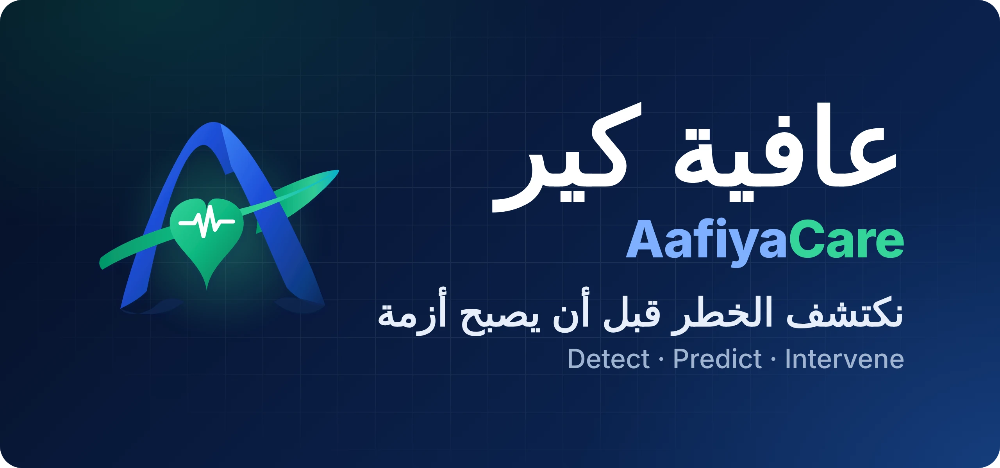
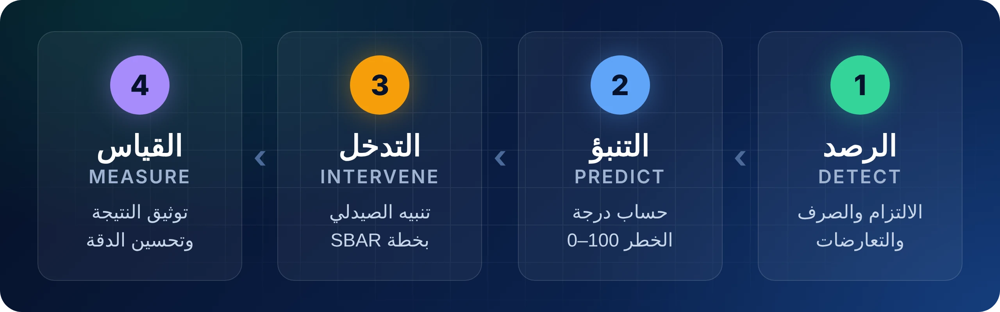
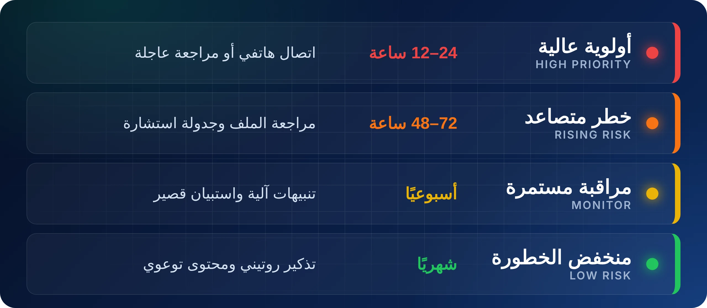
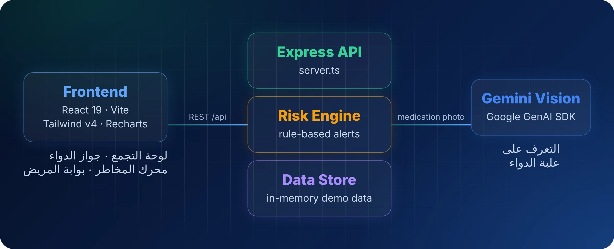
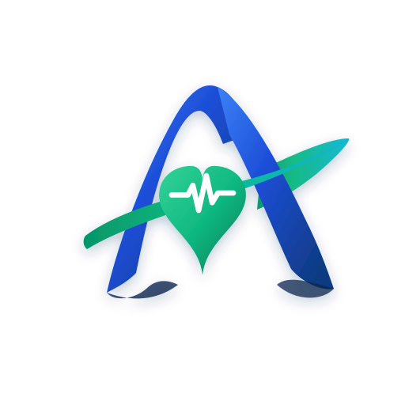

<p align="center">
  
</p>

<p align="center">
  <a href="./docs/PRD.md"></a>
  <a href="#التشغيل-المحلي"></a>
  <a href="#المعمارية-التقنية"></a>
</p>

<p align="center">
  
  
  
  
  
  
</p>

<div dir="rtl">

## الفكرة في سطرين

بعد خروج مريض الأمراض المزمنة من المستشفى، تختفي عن الفريق الطبي كل الإشارات المبكرة: انقطاع عن الدواء، تعارض بين الوصفات، تأخر في الصرف. وغالبًا لا يظهر الخلل إلا في الطوارئ.

**عافية كير** تسد هذه الفجوة: ترصد الإشارات، تحسب درجة خطر لكل مريض، وتضع أمام الصيدلي السريري قائمة أولويات مع خطة تدخل جاهزة بصيغة SBAR.

> 🤝 **الإنسان في الحلقة:** المنصة لا تتخذ قرارًا علاجيًا ولا تعدّل أي وصفة. دورها الفرز والتنبيه، والقرار للصيدلي أو الطبيب.

## ماذا نرصد؟

| | المحور | الإشارات |
| :---: | :--- | :--- |
| 🛡️ | **سلامة الدواء** | التعارضات الدوائية، الازدواجية العلاجية، أدوية قائمة Beers لكبار السن |
| ⏱️ | **الالتزام** | تراجع نسبة أخذ الجرعات في مواعيدها |
| 🔗 | **الاستمرارية** | فجوة ما بعد الخروج، ونفاد الدواء قبل موعد إعادة الصرف |
| ♻️ | **الهدر** | الأدوية الفائضة أو غير المستخدمة |

## كيف تعمل المنصة

</div>

<p align="center">
  
</p>

<div dir="rtl">

حلقة مغلقة: كل تدخل يُوثَّق بنتيجته، وهذه النتائج ترجع لتحسين دقة التنبيهات القادمة.

## مستويات الخطر

</div>

<p align="center">
  
</p>

<div dir="rtl">

## المزايا في النسخة الحالية

| الميزة | ماذا تقدم |
| :--- | :--- |
| 📊 **لوحة التجمع الصحي** | فرز المرضى حسب درجة الخطر، رسوم بيانية، وتنبيهات ذكية |
| 💊 **جواز الدواء الرقمي** | ملف دوائي موحّد لكل مريض، و**مسح علبة الدواء بالكاميرا** عبر Gemini Vision، وتصدير الجواز كملف |
| 🧠 **محرك المخاطر** | محاكاة حساب درجة الخطر وتصنيف المريض |
| 👴 **بوابة المريض** | واجهة مبسطة لكبار السن لتسجيل الجرعة بنقرة واحدة |
| 🩺 **التدخلات السريرية** | توصيات SBAR يقبلها الصيدلي أو يرفضها، مع سجل تدقيق كامل |
| 📈 **مؤشرات المنشأة** | الالتزام والتكلفة المتجنبة على مستوى التجمع |
| 🌐 **ثنائية اللغة** | الواجهة كاملة بالعربية والإنجليزية مع دعم RTL |

## المؤشرات المستهدفة

**مؤشر النجم الشمالي:** عدد الحالات عالية الخطورة التي رُصدت وعولجت قبل حدوث انتكاسة.

| المؤشر | المستهدف |
| :--- | :---: |
| دقة التنبيهات | **أكثر من 85%** |
| قبول الكادر الطبي للتوصيات | **أكثر من 80%** |
| خفض إعادة التنويم وزيارات الطوارئ | **20% – 30%** |
| خفض الهدر الدوائي | **25%** |
| زمن الرصد | **أقل من 24 ساعة** |
| زمن التدخل | **أقل من 48 ساعة** |

> 📌 هذه أرقام **مستهدفة** للتجربة الميدانية، وليست نتائج مقاسة.

## المعمارية التقنية

</div>

<p align="center">
  
</p>

<details dir="rtl">
<summary><b>واجهات البرمجة (API)</b></summary>
<br/>

| Method | Endpoint | الوظيفة |
| :--- | :--- | :--- |
| `GET` | `/api/health` | حالة الخادم وجاهزية Gemini |
| `GET` | `/api/kpis` | مؤشرات الأداء |
| `GET` | `/api/patients` | قائمة المرضى |
| `GET` | `/api/patients/:id` | تفاصيل مريض |
| `POST` | `/api/patients/:id/medications` | إضافة دواء للجواز |
| `DELETE` | `/api/patients/:id/medications/:medId` | حذف دواء |
| `POST` | `/api/patients/:id/doses` | جدولة جرعة |
| `POST` | `/api/patients/:id/doses/:doseId/log` | تسجيل أخذ الجرعة |
| `POST` | `/api/patients/:id/alerts/:alertId/ack` | تأكيد استلام تنبيه |
| `POST` | `/api/medications/scan` | التعرف على علبة دواء من صورة |
| `GET` | `/api/interventions` | قائمة التدخلات |
| `PATCH` | `/api/interventions/:id` | تحديث حالة تدخل |
| `GET` | `/api/audit-logs` | سجل التدقيق |

</details>

<details dir="rtl">
<summary><b>هيكل المشروع</b></summary>
<br/>

```text
Afiya-care-platform/
├── docs/
│   ├── PRD.md                    # Product Requirements Document
│   ├── AafiyaCare_PRD.pdf
│   └── assets/                   # README visuals
├── public/                       # logo.svg, favicon.svg
├── src/
│   ├── components/               # Dashboard, Passport, Risk Engine, Patient Portal, modals
│   ├── data/mockData.ts          # Demo patients, medications, alerts
│   ├── services/
│   │   ├── api.ts                # Frontend API client
│   │   └── riskAlertEngine.ts    # Risk alert generation
│   ├── utils/exportPassport.ts   # Health passport export
│   ├── types.ts
│   ├── App.tsx
│   └── main.tsx
├── server.ts                     # Express API + Gemini Vision
└── package.json
```

</details>

<div dir="rtl">

## التشغيل المحلي

**المتطلبات:** إصدار 20 أو أحدث من Node.js

</div>

```bash
git clone https://github.com/4-u1/Afiya-care-platform.git
cd Afiya-care-platform
npm install
npm run dev        # → http://localhost:3000
```

<div dir="rtl">

> 💡 المنصة تعمل كاملة **بدون أي مفتاح** باستخدام عينات المسح التجريبية. لتفعيل المسح الحي لصور الأدوية، أنشئ ملف البيئة من <code dir="ltr">.env.example</code> وأضف فيه مفتاح <code dir="ltr">GEMINI_API_KEY</code> من Google AI Studio.

| الأمر | الوظيفة |
| :--- | :--- |
| `npm run dev` | تشغيل الخادم والواجهة للتطوير |
| `npm run build` | بناء نسخة الإنتاج |
| `npm start` | تشغيل نسخة الإنتاج |
| `npm run lint` | فحص الأنواع عبر TypeScript |

## الحالة الحالية

هذه **نسخة أولية (MVP)** للعرض والتحكيم:

- البيانات تجريبية ومحفوظة في الذاكرة، وتعود لحالتها الأولى عند إعادة التشغيل.
- لا يوجد تكامل فعلي بعد مع صحتي أو وصفتي أو أنظمة المستشفيات.
- محرك المخاطر قائم على قواعد سريرية ثابتة، وليس نموذج تعلم آلة مدرّبًا بعد.
- لا يوجد تسجيل دخول أو صلاحيات بعد.

> ⚠️ المنصة غير معتمدة للاستخدام السريري، ولا يُعتمد عليها في أي قرار علاجي.

## خارطة الطريق

- [x] لوحة التجمع الصحي وفرز المرضى
- [x] جواز الدواء مع المسح بالكاميرا
- [x] توصيات التدخل بصيغة SBAR وسجل التدقيق
- [ ] قاعدة بيانات دائمة بدل التخزين في الذاكرة
- [ ] تسجيل دخول وصلاحيات حسب الدور
- [ ] تكامل عبر HL7 FHIR R4 مع أنظمة السجلات الصحية
- [ ] الربط مع صحتي ووصفتي
- [ ] نموذج تنبؤي مدرّب بعد الحصول على الموافقات
- [ ] استضافة داخل المملكة ومواءمة مع نظام حماية البيانات الشخصية وضوابط الأمن السيبراني
- [ ] تجربة ميدانية مع تجمع صحي

## الجهات المستهدفة

| الجهة | الدور |
| :--- | :--- |
| **التجمعات الصحية** | العميل الأساسي: الصيدلة السريرية والرعاية المنزلية |
| **منصة صحتي** | المؤشرات الحيوية والمواعيد (تكامل مخطط) |
| **منظومة وصفتي** | بيانات الصرف وإعادة الصرف (تكامل مخطط) |
| **هيئة الغذاء والدواء** | مرجع الأدوية المسجلة في المملكة |

## الفريق

| | العضو | الدور |
| :---: | :--- | :--- |
| 🧭 | **عبدالعزيز لاحق المطيري** | قائد المشروع · المنتج والشراكات |
| 🔐 | **يزيد حمد الحارثي** | البنية الخلفية والأمن · واجهات البرمجة وحماية البيانات |
| 🧠 | **مشاري خالد العصيمي** | الذكاء الاصطناعي · محرك المخاطر |
| 📱 | **أصيل سمير الحارثي** | الواجهات والرؤية الحاسوبية · تطبيق المريض وجواز الدواء |
| ☁️ | **فهد تركي الخماش** | السحابة وقواعد البيانات · التكامل والاعتمادية |

</div>

---

<p align="center">
  <br/>
  <b>AafiyaCare</b> · Team NEX · 2026
</p>
