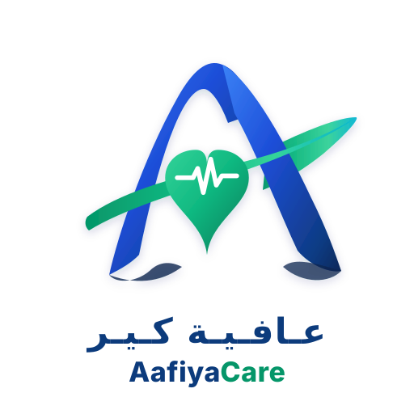
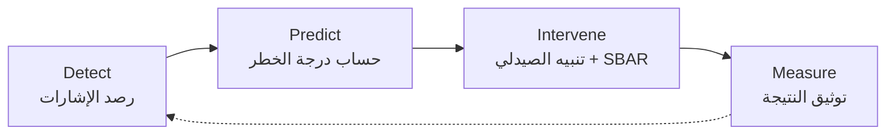
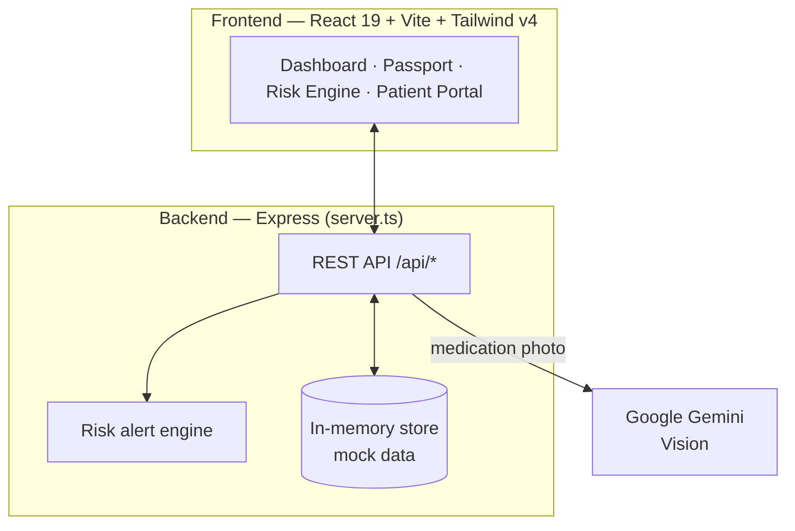

<div align="center">



# AafiyaCare · عافية كير

**Early clinical-risk intelligence for patients after hospital discharge**

<p dir="rtl">منصة ذكاء مبكر لرصد المخاطر الصحية والدوائية بعد خروج المريض من المستشفى</p>

*Detect Risk. Intervene Early. Improve Outcomes.*

[](#الحالة-الحالية-والقيود)
[](https://react.dev/)
[](https://www.typescriptlang.org/)
[](https://expressjs.com/)
[](https://tailwindcss.com/)
[](https://ai.google.dev/)
[](https://www.vision2030.gov.sa/)

[وثيقة المتطلبات (PRD)](./docs/PRD.md) · [PRD بصيغة PDF](./docs/AafiyaCare_PRD.pdf) · [التشغيل المحلي](#التشغيل-المحلي)

</div>

---

<div dir="rtl">

## نبذة

تبدأ رحلة العلاج الفعلية لمرضى الأمراض المزمنة وكبار السن في بيوتهم، بعيدًا عن الطبيب والصيدلي. في هذه الفترة تضيع الإشارات المبكرة: انقطاع عن الدواء، تعارضات بين الوصفات، تأخر في إعادة الصرف، ثم زيارة طوارئ أو تنويم كان يمكن تفاديه.

**عافية كير** منصة B2B موجّهة للتجمعات الصحية، ترصد هذه الإشارات وتحسب درجة خطر لكل مريض، وتعرض على الصيدلي السريري قائمة أولويات مع توصية تدخل مكتوبة بصيغة SBAR.

> **مبدأ أساسي — الإنسان في الحلقة (Human-in-the-Loop):**
> المنصة لا تتخذ قرارًا علاجيًا ولا تعدّل وصفة. دورها الفرز والتنبيه فقط، والقرار السريري للصيدلي أو الطبيب.

## المشكلة التي نعالجها

| المحور | ما نرصده |
| :--- | :--- |
| **سلامة الدواء** | التعارضات الدوائية، الازدواجية العلاجية، أدوية قائمة Beers لكبار السن |
| **الالتزام** | تراجع نسبة أخذ الجرعات في مواعيدها |
| **الاستمرارية** | الفجوة بعد الخروج من المستشفى ونفاد الدواء قبل إعادة الصرف |
| **الهدر** | الأدوية الفائضة أو غير المستخدمة |

## المزايا الموجودة في النسخة الحالية

| الشاشة | الوصف | الملف |
| :--- | :--- | :--- |
| **لوحة التجمع الصحي** | فرز المرضى حسب درجة الخطر، رسوم بيانية، تنبيهات ذكية | `DashboardView.tsx` |
| **جواز الدواء** | ملف دوائي موحّد لكل مريض، مع **مسح علبة الدواء بالكاميرا** عبر Gemini Vision، وتصدير الجواز كملف HTML | `MedicationPassportView.tsx` |
| **محرك المخاطر** | محاكاة لحساب درجة الخطر وتصنيفها | `RiskEngineView.tsx` · `riskAlertEngine.ts` |
| **بوابة المريض** | واجهة مبسطة لكبار السن لتسجيل الجرعة بنقرة | `PatientPortalView.tsx` |
| **التدخلات السريرية** | توصيات بصيغة SBAR مع قبول أو رفض من الصيدلي، وسجل تدقيق | `InterventionsModal.tsx` |
| **مؤشرات الأداء** | مؤشرات الالتزام والتكلفة المتجنبة على مستوى المنشأة | `EnterpriseMetricsView.tsx` |
| **عربي / إنجليزي** | الواجهة كاملة باللغتين مع دعم RTL | `App.tsx` |

## آلية العمل

</div>



<div dir="rtl">

### مستويات الخطر

| المستوى | زمن الاستجابة المستهدف | الإجراء |
| :--- | :--- | :--- |
| 🔴 **عالي** | 12–24 ساعة | تواصل هاتفي أو مراجعة عاجلة |
| 🟠 **متصاعد** | 48–72 ساعة | مراجعة الملف وجدولة استشارة |
| 🟡 **مراقبة** | أسبوعيًا | تنبيهات آلية للمريض واستبيان قصير |
| 🟢 **منخفض** | شهريًا | تذكير روتيني ومحتوى توعوي |

## المؤشرات المستهدفة

**مؤشر النجم الشمالي:** عدد الحالات عالية الخطورة التي رُصدت وعولجت قبل حدوث انتكاسة.

| المؤشر | المستهدف |
| :--- | :--- |
| دقة التنبيهات (Signal Precision) | أكثر من 85% |
| قبول الكادر للتوصيات | أكثر من 80% |
| خفض إعادة التنويم وزيارات الطوارئ | 20%–30% |
| خفض الهدر الدوائي | 25% |
| زمن الرصد / زمن التدخل | أقل من 24 ساعة / 48 ساعة |

> هذه **مستهدفات** للتجربة الميدانية، وليست نتائج مقاسة.

## المعمارية

</div>



<div dir="rtl">

### واجهات الـ API

| Method | Endpoint | الوظيفة |
| :--- | :--- | :--- |
| `GET` | `/api/health` | حالة الخادم وهل مفتاح Gemini مهيأ |
| `GET` | `/api/kpis` | مؤشرات الأداء |
| `GET` | `/api/patients` · `/api/patients/:id` | قائمة المرضى وتفاصيل مريض |
| `POST` / `DELETE` | `/api/patients/:id/medications` | إضافة دواء أو حذفه من الجواز |
| `POST` | `/api/patients/:id/doses` · `.../doses/:doseId/log` | جدولة جرعة وتسجيلها |
| `POST` | `/api/patients/:id/alerts/:alertId/ack` | تأكيد استلام تنبيه |
| `POST` | `/api/medications/scan` | التعرف على علبة دواء من صورة |
| `GET` / `PATCH` | `/api/interventions` | عرض التدخلات وتحديث حالتها |
| `GET` | `/api/audit-logs` | سجل التدقيق |

## هيكل المشروع

</div>

```text
Afiya-care-platform/
├── docs/
│   ├── PRD.md                    # Product Requirements Document
│   └── AafiyaCare_PRD.pdf
├── public/
│   ├── logo.svg
│   └── favicon.svg
├── src/
│   ├── components/               # Dashboard, Passport, Risk Engine, Patient Portal, modals
│   ├── data/mockData.ts          # Demo patients, medications, alerts
│   ├── services/
│   │   ├── api.ts                # Frontend API client
│   │   └── riskAlertEngine.ts    # Risk alert generation logic
│   ├── utils/exportPassport.ts   # Health passport HTML export
│   ├── types.ts
│   ├── App.tsx
│   └── main.tsx
├── server.ts                     # Express API + Gemini Vision integration
├── vite.config.ts
└── package.json
```

<div dir="rtl">

## التشغيل المحلي

**المتطلبات:** Node.js 20 أو أحدث. مفتاح Gemini اختياري: بدونه تعمل المنصة كاملة بعينات المسح التجريبية، ومعه يعمل المسح الحي للصور.

</div>

```bash
git clone https://github.com/4-u1/Afiya-care-platform.git
cd Afiya-care-platform
npm install

cp .env.example .env      # optional: add GEMINI_API_KEY
npm run dev               # http://localhost:3000
```

<div dir="rtl">

| الأمر | الوظيفة |
| :--- | :--- |
| `npm run dev` | تشغيل الخادم والواجهة في وضع التطوير |
| `npm run build` | بناء نسخة الإنتاج في `dist/` |
| `npm start` | تشغيل نسخة الإنتاج |
| `npm run lint` | فحص الأنواع عبر TypeScript |

## الحالة الحالية والقيود

هذه **نسخة أولية (MVP)** لغرض العرض والتحكيم:

- البيانات **تجريبية** ومحفوظة في الذاكرة، وتُعاد عند إعادة تشغيل الخادم.
- لا يوجد تكامل فعلي بعد مع صحتي أو وصفتي أو أنظمة المستشفيات.
- منطق المخاطر قائم على قواعد (rule-based)، وليس نموذج تعلم آلة مدرّبًا.
- لا يوجد تسجيل دخول أو صلاحيات بعد.

> ⚠️ **تنبيه:** المنصة غير معتمدة للاستخدام السريري، ولا يُعتمد عليها في أي قرار علاجي.

## خارطة الطريق

- [ ] قاعدة بيانات دائمة (PostgreSQL) بدل التخزين في الذاكرة
- [ ] تسجيل دخول وصلاحيات حسب الدور (RBAC)
- [ ] تكامل عبر HL7 FHIR R4 مع أنظمة السجلات الصحية
- [ ] الربط مع منصتي صحتي ووصفتي
- [ ] نموذج تنبؤي مدرّب على بيانات حقيقية بعد الحصول على الموافقات
- [ ] استضافة محلية داخل المملكة ومواءمة مع نظام حماية البيانات الشخصية (PDPL) وضوابط NCA
- [ ] تجربة ميدانية مع تجمع صحي

## الجهات المستهدفة

| الجهة | دورها في المنصة |
| :--- | :--- |
| **التجمعات الصحية** | العميل الأساسي: فرق الصيدلة السريرية والرعاية المنزلية |
| **منصة صحتي** | مصدر المؤشرات الحيوية والمواعيد (تكامل مخطط) |
| **منظومة وصفتي** | مصدر بيانات الصرف وإعادة الصرف (تكامل مخطط) |
| **هيئة الغذاء والدواء (SFDA)** | مرجع الأدوية المسجلة في المملكة |

## الفريق

| العضو | التخصص | الدور |
| :--- | :--- | :--- |
| **عبدالعزيز لاحق المطيري** | تقنية معلومات | قائد المشروع — المنتج والشراكات |
| **يزيد حمد الحارثي** | هندسة حاسب | البنية الخلفية والأمن — الـ APIs وحماية البيانات |
| **مشاري خالد العصيمي** | علوم حاسب | الذكاء الاصطناعي — محرك المخاطر ومنطق التصنيف |
| **أصيل سمير الحارثي** | هندسة حاسب | الواجهات والرؤية الحاسوبية — تطبيق المريض وجواز الدواء |
| **فهد تركي الخماش** | تقنية معلومات | السحابة وقواعد البيانات — تكامل البيانات والاعتمادية |

</div>

---

<div align="center">

**AafiyaCare** — Team NEX · 2026

</div>
